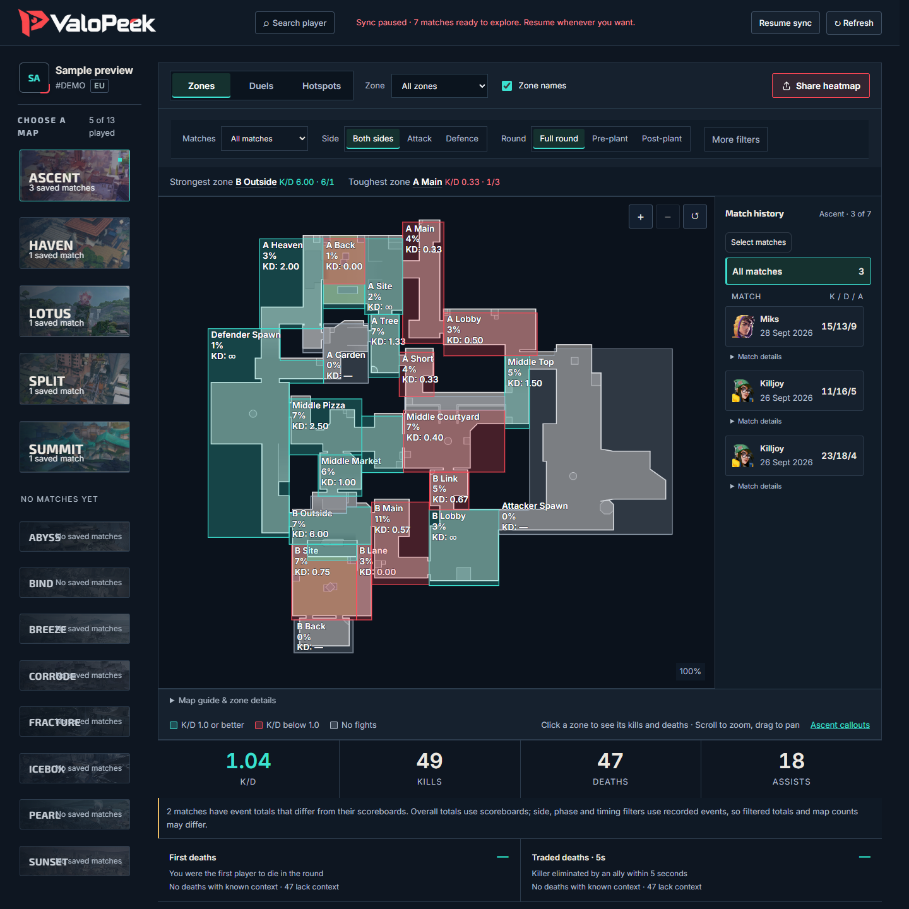
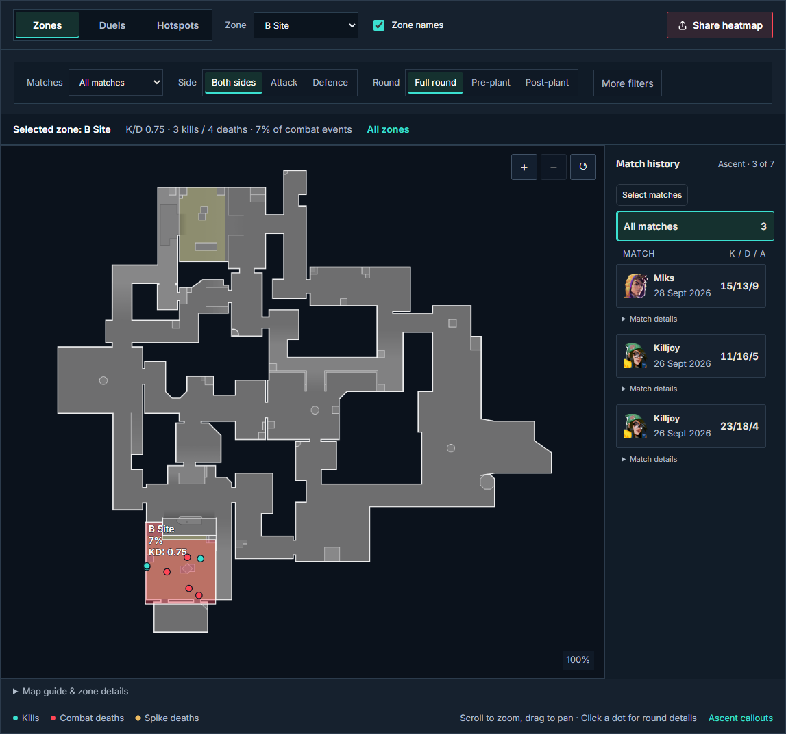
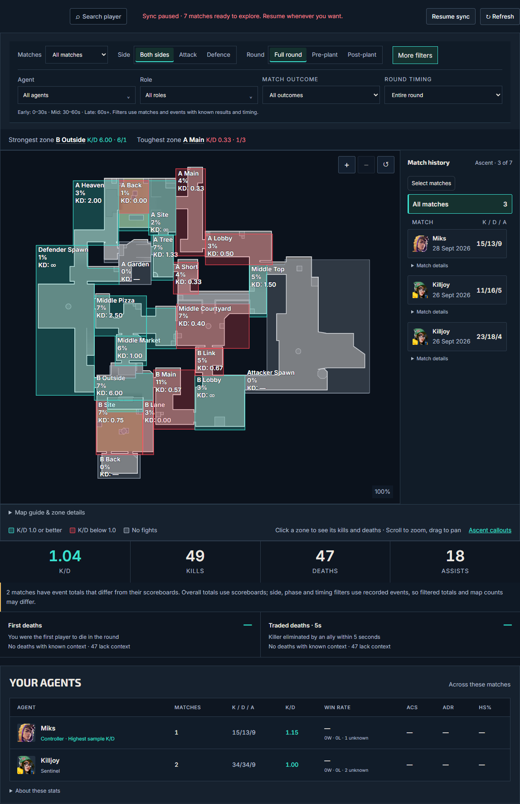
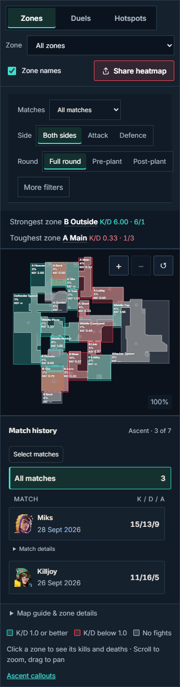
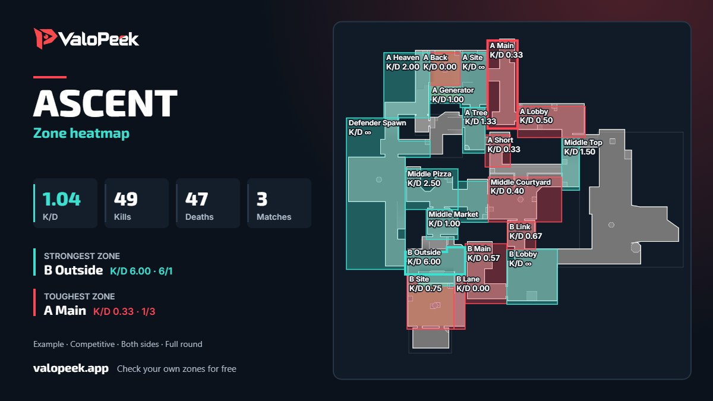

# ValoPeek — Free VALORANT Map Stats, K/D Tracker & Map Callouts

<a href="https://valopeek.app/">
  <picture>
    <source media="(prefers-color-scheme: dark)" srcset="assets/brand/logo.png">
    
  </picture>
</a>

**Understand your results on each map. Review the fights behind your K/D. Learn the callouts that put those fights into context.**

[**Open ValoPeek →**](https://valopeek.app/) · [Map stats guide](docs/MAP-STATS.md) · [Map callouts](docs/MAP-CALLOUTS.md) · [Discord](https://discord.gg/nzQyaQKg2x)

ValoPeek is a free, browser-based VALORANT stats website for reviewing your own completed Competitive matches. Enter your Riot name and tag to explore available current-act history, compare personal map performance, and inspect recorded kills and deaths by zone.

This repository is the public product guide and screenshot showcase. The analysis tool runs at **[valopeek.app](https://valopeek.app/)**. No download, application server setup or Riot password is required.

## Explore this guide

- [What ValoPeek helps you review](#what-valopeek-helps-you-review)
- [VALORANT map stats and personal K/D](#valorant-map-stats-and-personal-kd)
- [Filters and match selection](#filters-and-match-selection)
- [Map callouts and locations](#map-callouts-and-locations)
- [Getting started](#getting-started)
- [A worked Ascent example](#a-worked-ascent-example)
- [Product vision](#product-vision)
- [Frequently asked questions](#frequently-asked-questions)
- [Feedback and support](#feedback-and-support)

## What ValoPeek helps you review

An overall match score can hide differences between maps, areas and situations. ValoPeek gives you a way to ask more specific questions:

- Which map zones contain the fights I should review?
- Where did my recorded kills and deaths happen?
- Do my results change between attack and defence?
- What happens when I separate pre-plant and post-plant fights?
- How do my personal agent results compare in selected matches?
- Which round should I inspect to understand a particular fight?

The maps and numbers help you choose a review question. They do not replace round context or guarantee that a position is good or bad.

## VALORANT map stats and personal K/D

*Current interface with anonymized sample matches. The account is labelled “Sample preview”.*

### K/D by map zone

See combat kills and deaths grouped into map areas. Each zone's K/D is calculated from the events available after your selected filters. Select a zone to inspect the fights contributing to its result.

*Sample data: Ascent B Site selected, three recorded kills and four deaths. Zone K/D: 0.75.*

### Recorded fight locations and duels

Positioned events show where kills and deaths were recorded. When both player and opponent positions are available, duel lines connect the endpoints. These are snapshots from completed matches, not continuous movement or a live enemy feed.

### Match details and tactical round timelines

Open available match details and rounds to investigate the events behind a result. Tactical round timelines provide another way to review a fight in context. Coverage depends on the detail available for the match.

### Personal agent stats

Compare your own selected results on the agents you played. Available full-match metrics include win rate, ACS, ADR and headshot percentage. These scoreboard metrics do not follow every side, phase or event-timing filter. Unavailable values are not treated as zero.

[**Read the map stats and K/D guide →**](docs/MAP-STATS.md)

## Filters and match selection

Keep the match selection consistent when comparing results.

| Control | What it helps you review |
| --- | --- |
| Map selection | Results on a particular map |
| Recent or custom match selection | A specific group of available matches |
| Attack / defence | Results on each side |
| Pre-plant / post-plant | Fights around different round phases |
| Agent and role | Personal results within those selections |
| Match outcome and round timing | A narrower group of available events |
| Zones, duels and hotspots | Different views of recorded fights |

<strong>See the expanded filter controls</strong>

*Current filter interface with sample data. The sample lacks some event context, so not all filters produce meaningful comparisons from this fixture.*

Filtered event totals can differ from scoreboard totals when positions or context are unavailable.

## Map callouts and locations

Connect the names in team comms to areas on the map. ValoPeek publishes labelled map pages to use alongside your personal stats.

| Map | Explore labelled locations |
| --- | --- |
| Ascent | [Ascent map callouts](https://valopeek.app/maps/ascent/) |
| Bind | [Bind map callouts](https://valopeek.app/maps/bind/) |
| Haven | [Haven map callouts](https://valopeek.app/maps/haven/) |
| Split | [Split map callouts](https://valopeek.app/maps/split/) |
| Lotus | [Lotus map callouts](https://valopeek.app/maps/lotus/) |
| Sunset | [Sunset map callouts](https://valopeek.app/maps/sunset/) |
| Icebox | [Icebox map callouts](https://valopeek.app/maps/icebox/) |
| Breeze | [Breeze map callouts](https://valopeek.app/maps/breeze/) |
| Fracture | [Fracture map callouts](https://valopeek.app/maps/fracture/) |
| Pearl | [Pearl map callouts](https://valopeek.app/maps/pearl/) |
| Abyss | [Abyss map callouts](https://valopeek.app/maps/abyss/) |
| Corrode | [Corrode map callouts](https://valopeek.app/maps/corrode/) |
| Summit | [Summit map callouts](https://valopeek.app/maps/summit/) |

This is the map library, not the current ranked rotation. Community shorthand may differ from map labels, and historical artwork or zone boundaries can change.

[Browse all map callouts](https://valopeek.app/maps/) · [Use callouts in your review](docs/MAP-CALLOUTS.md)

## Getting started

1. **[Open ValoPeek](https://valopeek.app/).** Use the website in your browser.
2. **Enter your Riot name and tag.** Request your available current-act Competitive history.
3. **Choose a map and matches.** Start with a recent group or a custom selection.
4. **Review a zone.** Inspect the recorded fights behind its K/D.
5. **Add context.** Compare sides, phases and available round details before drawing a conclusion.

Imports can take time. Requested work persists after a page closure and can resume after an API restart. Saved results remain available while more history is prepared. Refresh explicitly retries or resumes work; Pause applies to the individual account.

<strong>See the current mobile map panel</strong>

*Actual panel captured at a 390-pixel browser width. Anonymized sample matches.*

## A worked Ascent example

*Shareable export from three sample Competitive matches. Both sides, full round.*

The overall K/D is **1.04**, from 49 kills and 47 deaths. Two zones show different recorded results:

| Zone | Kills | Deaths | K/D |
| --- | ---: | ---: | ---: |
| B Outside | 6 | 1 | 6.00 |
| A Main | 1 | 3 | 0.33 |

These small counts suggest fights to review, not a verdict about either location. A busy zone can contain more deaths simply because you fight there more often. Compare the rounds, sides and situations behind the numbers.

You can export selected zone analysis as an image for discussion with teammates or sharing in a community.

## Product vision

We are building ValoPeek to make personal VALORANT match review easier to understand: connect the scoreboard to the map, show where data is incomplete, and make interesting fights easier to discuss.

Our direction is clearer map context, understandable personal statistics and useful sharing. Player feedback helps shape what comes next. Future goals are not a promise of features already available.

[Read the product vision](docs/VISION.md) · [Suggest an improvement](https://github.com/jikouken01/valopeek-valorant-map-stats/issues)

## Frequently asked questions

### Is ValoPeek free?

The current analysis controls are free. Review map stats, use filters and inspect available match details in your browser.

### Do I need an account, download or Riot password?

No download or sign-up is required for the current flow. Enter your Riot name and tag. ValoPeek never asks for your Riot password.

### Which matches are included?

Available current-act Competitive matches. Older acts and other modes are not included in the current flow. Provider coverage, positions and details can be incomplete.

### Is zone K/D the same as full-match K/D?

No. Zone K/D uses classified combat events in an area after event filters. Overall totals use match scoreboards. Missing positions or context can make the two differ.

### Does a red zone mean I should never play there?

No. It means the selected recorded combat events have K/D below 1.0. Sample size and round context matter. It does not measure survival probability or time spent in the area.

### Does ValoPeek track enemies live?

No. It uses recorded events from completed matches, without live enemy tracking or continuous movement data.

### Are these global agent or map win rates?

No. ValoPeek focuses on your own available matches. Personal statistics are not population-wide meta statistics.

### Is ValoPeek endorsed by Riot Games?

No. ValoPeek is independent. Read the [Riot notice](https://valopeek.app/legal/) and [privacy information](https://valopeek.app/privacy/).

## Feedback and support

- [Discord community](https://discord.gg/nzQyaQKg2x): questions and discussions.
- [Issues and feature suggestions](https://github.com/jikouken01/valopeek-valorant-map-stats/issues): public feedback for this guide.
- [Contact ValoPeek](https://valopeek.app/contact/): product support.
- [Analysis guide](https://valopeek.app/guide/): additional explanations in the app.

When reporting a problem, describe the map, browser and steps. Do not post credentials or private account information.

## About this repository

This repository documents ValoPeek's product, examples and direction. It is not an application source-code distribution. Screenshots use anonymized sample data; [capture provenance and limitations](assets/screenshots/README.md) are included.

**Last reviewed: 11 October 2026.** Features and available history can change.

ValoPeek is not endorsed by Riot Games and does not reflect the views or opinions of Riot Games or anyone officially involved in producing or managing Riot Games properties. Riot Games, VALORANT and associated properties are trademarks or registered trademarks of Riot Games, Inc.

---

[**Explore your VALORANT map stats on ValoPeek →**](https://valopeek.app/)
