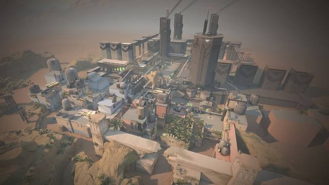
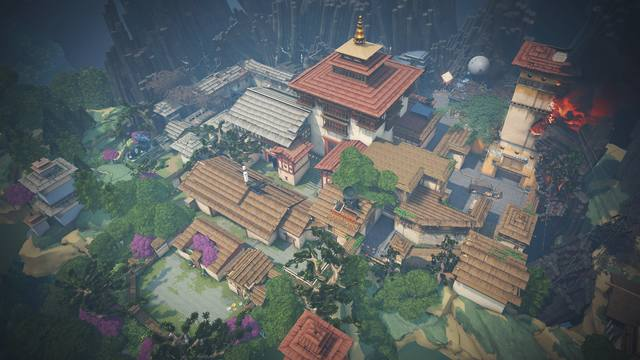

# VALORANT map callouts: connect locations to match review

[Product guide](../README.md) · [Labelled map library](https://valopeek.app/maps/)

VALORANT map callouts are the names players use to identify locations. A labelled map connects a name in comms to an area. The same names help you explain where a recorded fight happened during review.

## Learn the names in context

Start with sites, main entrances and connecting routes. Then learn the locations your teammates mention most. Community shorthand can differ from map labels, so agree on the wording with your group.

### Ascent

Locate A Main, Mid and the routes to each site. When reviewing personal map stats, distinguish a specific area from the site as a whole.

[Open Ascent map callouts](https://valopeek.app/maps/ascent/)

### Bind

Connect names such as Showers and Hookah to their locations. A specific callout identifies which fight you mean when discussing a round.

[Open Bind map callouts](https://valopeek.app/maps/bind/)

### Haven

With three sites, distinguishing a site, entrance and connector matters when describing a rotation or recorded fight.

[Open Haven map callouts](https://valopeek.app/maps/haven/)

### More maps

- [Split](https://valopeek.app/maps/split/)
- [Lotus](https://valopeek.app/maps/lotus/)
- [Sunset](https://valopeek.app/maps/sunset/)
- [Icebox](https://valopeek.app/maps/icebox/)
- [Breeze](https://valopeek.app/maps/breeze/)
- [Fracture](https://valopeek.app/maps/fracture/)
- [Pearl](https://valopeek.app/maps/pearl/)
- [Abyss](https://valopeek.app/maps/abyss/)
- [Corrode](https://valopeek.app/maps/corrode/)
- [Summit](https://valopeek.app/maps/summit/)

This is the map library, not the current ranked rotation. The images here are artwork; follow the links for labelled diagrams.

## Use callouts with personal map stats

1. Choose a map and consistent match set.
2. Select a zone and inspect its recorded fights.
3. Check the location's callout on the labelled map.
4. Name the side and phase when that context exists.
5. Review the round before drawing a conclusion from K/D.

“Let's review A Main deaths on attack before the plant” is a clearer question than “I keep dying somewhere near A.”

A callout identifies a place. Personal map K/D describes recorded events in an area after filters. Neither alone explains why you won or lost a fight. Historical boundaries may differ from current artwork, and event coverage can be incomplete.

[Understand your map stats](MAP-STATS.md) · [Explore ValoPeek](https://valopeek.app/)

Last reviewed: 11 October 2026. Map artwork belongs to Riot Games.
